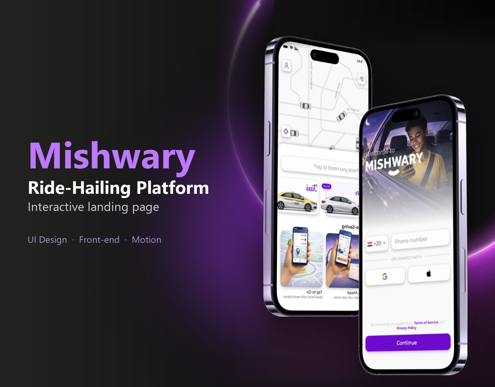
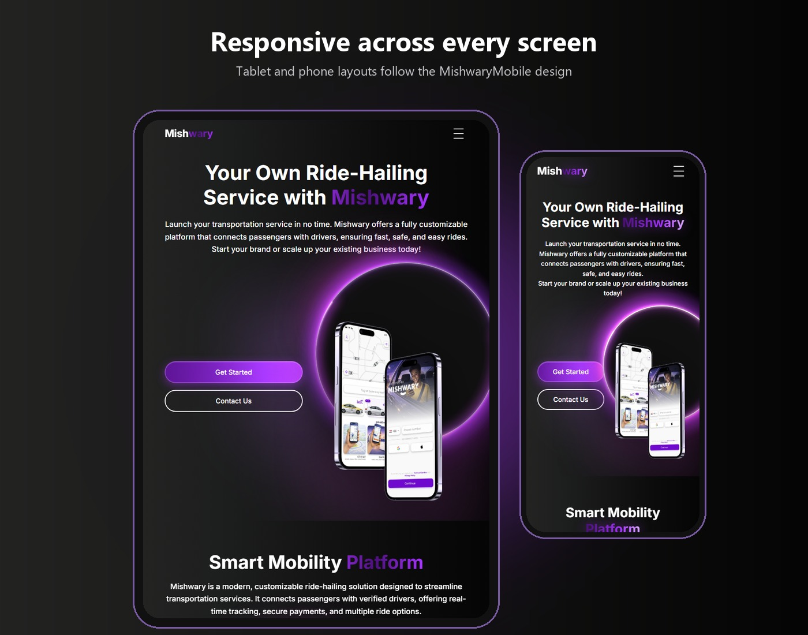

# Mishwary — Interactive Landing Page

**🔗 Live demo: [rahmamandoh.github.io/Mishwary_UI](https://rahmamandoh.github.io/Mishwary_UI/)**

An interactive, fully responsive landing page for **Mishwary**, a white-label ride-hailing platform that connects riders, drivers and admins. Designed in Figma and built with plain HTML, CSS and JavaScript, with no frameworks and no build step.



## Highlights
- **Faithful to the Figma design.** Each desktop section is scaled from its Figma frame, so sizes and spacing match the design at any desktop width.
- **Glow and motion.** Neon rings that pulse, a shine that travels around them, breathing light blobs, floating phones and cards, and a shimmer on the highlighted word in each title.
- **Seamless page.** One continuous background with soft edge fades, so there are no hard lines between sections.
- **Responsive.**
  - Phones follow the dedicated mobile design in Figma: swipe carousels for the cards, and chips floating around the phones.
  - Tablets (up to 1279px) get a mix of the mobile and desktop layouts.
- **Interactions.**
  - Sticky navigation that highlights the current section.
  - Hamburger menu on tablet and phone.
  - Scroll-reveal animations.
  - Cards with a spotlight that follows the cursor.
  - Journey steps that cycle on their own.
  - A validated "Get Started / Contact Us" form. This is a prototype, so nothing is actually sent.
- **Accessibility.** Respects `prefers-reduced-motion`.



## Tech
HTML · CSS (container query units, masks, blend modes) · Vanilla JavaScript · Figma · GitHub Pages

## Run locally
No build step. Open `index.html` directly, or serve the folder:

```bash
python -m http.server 5173
```

Then visit http://localhost:5173.

## Structure
```
index.html        page markup (sections M1–M8)
styles.css        design tokens, layout, animations, responsive rules
script.js         interactions
assets/img/       phone / tablet mockups from Figma (WebP)
assets/glow/      glow ring, arc and light layers from Figma (SVG)
assets/icons/     feature icons (SVG)
docs/             README images
```

## Deployment
Deployed with **GitHub Pages** from the `main` branch (root). Every push to `main` updates the live site within a minute or two.
